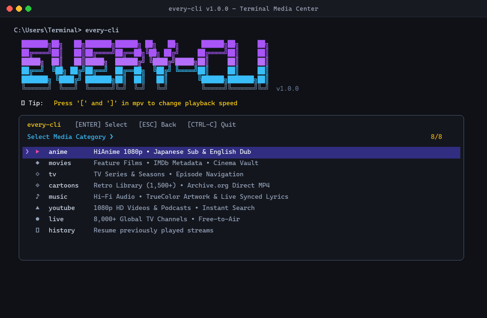
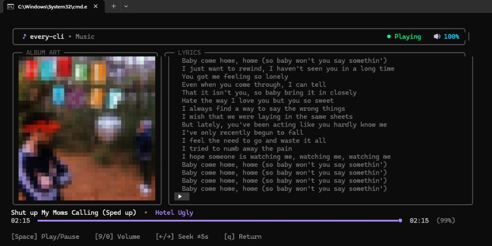
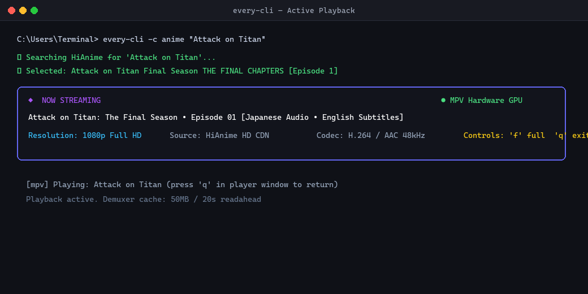

# every-cli

<div align="center">

**Universal Terminal Streaming Client & Media Center**  
*Anime • Movies • TV Series • Cartoons • Music with Lyrics • YouTube • Live TV*

[](LICENSE)
[](#installation)
[](#architecture--built-with)
[](https://mpv.io)

<br/>



</div>

---

## Previews & Screenshots

| Terminal Music Player (TrueColor Cover Art & Synced Lyrics) | Hardware-Accelerated Video Playback |
|:---:|:---:|
|  |  |

---

```
  ███████╗██╗   ██╗███████╗██████╗ ██╗   ██╗      ██████╗██╗     ██╗
  ██╔════╝██║   ██║██╔════╝██╔══██╗╚██╗ ██╔╝     ██╔════╝██║     ██║
  █████╗  ██║   ██║█████╗  ██████╔╝ ╚████╔╝█████╗██║     ██║     ██║
  ██╔══╝  ╚██╗ ██╔╝██╔══╝  ██╔══██╗  ╚██╔╝ ╚════╝██║     ██║     ██║
  ███████╗ ╚████╔╝ ███████╗██║  ██║   ██║        ╚██████╗███████╗██║
  ╚══════╝  ╚═══╝  ╚══════╝╚═╝  ╚═╝   ╚═╝         ╚═════╝╚══════╝╚═╝  v1.0.0

  💡 Tip: Press '[' and ']' in mpv to change playback speed

  Select Media Category ❯
  > ▶   anime       HiAnime 1080p • Japanese Sub & English Dub
    ◆   movies      Feature Films • IMDb Metadata • Cinema Vault
    ◇   tv          TV Series & Seasons • Episode Navigation
    ◈   cartoons    Retro Library (1,500+) • Archive.org Direct MP4
    ♪   music       Hi-Fi Audio • TrueColor Artwork & Live Synced Lyrics
    ▲   youtube     1080p HD Videos & Podcasts • Instant Search
    ●   live        8,000+ Global TV Channels • Free-to-Air
    ↺   history     Resume previously played streams
```

---

## Architecture & Built-With

`every-cli` is written as a modular, dependency-minimal POSIX shell suite. It contains zero heavy runtimes (no Node.js, Electron, or Python daemon)—it executes directly via standard Unix primitives and tools:

- **POSIX `sh` Core** — 100% portable across Linux distros (Debian, Arch, Alpine, Fedora, Void, Ubuntu), macOS, BSD, and Windows (via Git Bash / MSYS2).
- **`mpv` Video Player** — Hardware-accelerated video decoding (`--hwdec=auto`) with native HLS `.m3u8` playlist parsing, custom HTTP referrers, and dual audio-track switching.
- **`yt-dlp` Stream Resolver** — Resolves variable stream bitrates, synchronizes video and audio streams, and handles download packaging.
- **`fzf` Fuzzy Interactive TUI** — Terminal fuzzy finder with custom keybindings (`[ENTER]` select, `[ESC]` go back), dynamic live search, and reverse layout.
- **`curl` Network Engine** — HTTP requests with gzip/deflate compression, browser User-Agent spoofing, and Cloudflare bypass capability via `curl-impersonate`.
- **In-Place ANSI Spinner** — Background subshell tracking with zero-flicker animated spinner (`/-\|`) redirected to `stderr`, keeping data pipelines pure.

---

## Sources & Scrapers

`every-cli` routes queries through multi-tier fallback chains to guarantee playback:

| Category | Primary Source | Secondary Source | Fallback Source | Stream Type |
|---|---|---|---|---|
| **Anime** | HiAnime (`hianime.to`) | AllAnime (`api.allanime.day`) | YouTube HD | 1080p HLS (`m3u8`) / Dual Audio |
| **Movies** | IMDb API + Archive.org | VidSrc streaming embeds | YouTube HD | Direct MP4 / 1080p HLS |
| **TV Series** | IMDb API + Archive.org | VidSrc episode embeds | YouTube HD | Direct MP4 / 1080p HLS |
| **Cartoons** | SuperCartoons (1,500+) | Archive.org Animation | HiAnime / YouTube | Direct MP4 (480p–1080p) |
| **Music** | YouTube Music / yt-dlp | MusicBrainz Metadata | — | 320kbps Audio-Only / MP3 Download |
| **YouTube** | yt-dlp search engine | — | — | 1080p / 720p / 480p / Audio-Only |
| **Live TV** | iptv-org index | Category playlists | — | Live HLS Streams |

### Details on Providers Used:
1. **HiAnime** (`hianime.to`): Scrapes encrypted episode IDs and retrieves multi-bitrate master HLS streams (`.m3u8`) with selectable Japanese audio (Sub) and English audio (Dub).
2. **AllAnime** (`api.allanime.day`): GraphQL API querying show titles, available episode lists, and decrypted video endpoints.
3. **IMDb Suggestions API** (`v3.sg.media-imdb.com`): Official IMDb suggestion endpoints for instant, accurate metadata resolution (IMDb ID, title, year, media type, and cast).
4. **Internet Archive** (`archive.org`): Public digital archive querying complete preserved television seasons, historical cinema, and classic cartoon series (e.g., *Ben 10*, *Batman: The Animated Series*, *Looney Tunes*) served in direct high-bitrate MP4.
5. **SuperCartoons** (`supercartoons.net`): Database of over 1,500 classic animated theatrical shorts from Warner Bros, Disney, MGM, and Paramount streamed via direct MP4 links.
6. **iptv-org** (`iptv-org.github.io`): Over 8,000 public broadcast and free-to-air international live television channels organized by category (news, sports, movies, animation, kids, music, documentaries).
7. **LRCLIB** (`lrclib.net`): Free open database of synchronized karaoke lyrics with millisecond timestamps and full song text.
8. **Terminal Music Engine**: Photorealistic 24-bit TrueColor halfblock album cover art (`▀`) and live synchronized lyric scrolling right inside the terminal window.

---

## Installation

### Linux & BSD

#### Method 1: Using `make` (Recommended)
```sh
git clone https://github.com/pythoncoder6769-create/every-cli.git
cd every-cli
sudo make install
```
To uninstall: `sudo make uninstall`

#### Method 2: Using `install.sh`
```sh
chmod +x install.sh
sudo ./install.sh
```
To uninstall: `sudo ./install.sh --uninstall`

#### Package Dependencies (Linux)
- **Arch / Manjaro**: `sudo pacman -S curl fzf mpv yt-dlp ffmpeg`
- **Debian / Ubuntu / Mint**: `sudo apt install curl fzf mpv yt-dlp ffmpeg`
- **Fedora**: `sudo dnf install curl fzf mpv yt-dlp ffmpeg`
- **Alpine**: `sudo apk add curl fzf mpv yt-dlp ffmpeg`
- **Void**: `sudo xbps-install -S curl fzf mpv yt-dlp ffmpeg`

---

### macOS

Install dependencies via Homebrew:
```sh
brew install curl fzf mpv yt-dlp ffmpeg
```
Install `every-cli`:
```sh
git clone https://github.com/pythoncoder6769-create/every-cli.git
cd every-cli
sudo make install
```

---

### Windows 11 / 10

`every-cli` runs seamlessly on Windows inside Windows Terminal, Command Prompt, PowerShell, or Git Bash.

1. **Automatic Scoop Installer (PowerShell)**:
   ```powershell
   .\install.ps1
   ```
2. **Direct Run**:
   Run `every-cli` directly from Command Prompt or PowerShell within the project folder:
   ```cmd
   every-cli
   ```
   The included `every-cli.cmd` launcher automatically sets UTF-8 code page `65001`, locates your Git Bash environment, detects `mpv` and `fzf`, and starts the player with proper signal traps.

---

## Usage

```
every-cli [OPTIONS] [QUERY]

OPTIONS:
  -c, --category CATEGORY   anime | movies | tv | cartoons | youtube | live
  -e, --episode EP          Episode number or range (e.g. 5 or 1-12)
  -q, --quality Q           best | 1080 | 720 | 480 | 360 (default: best)
  -d, --download            Download video instead of streaming
      --dub                 Use English dub (anime)
      --vlc                 Use VLC instead of mpv
      --no-color            Disable terminal ANSI colors
      --continue            Resume previous stream from history
  -U, --update              Update script from repository
  -v, --version             Print version number
  -h, --help                Display this help reference
```

### Examples

```sh
# Open the interactive category menu
every-cli

# Stream anime in 1080p English dub
every-cli -c anime --dub -q 1080 "Attack on Titan"

# Stream a TV series (prompts for season & episode)
every-cli -c tv "Mr. Robot"

# Stream public cinema
every-cli -c movies "Night of the Living Dead"

# Stream retro cartoons in direct MP4
every-cli -c cartoons "Ben 10"

# Stream music in highest quality (audio-only, terminal controls)
every-cli -c music "Eminem Lose Yourself"

# Download song as high-quality MP3 with metadata & album art
every-cli -c music -d "Imagine Dragons Believer"

# Stream YouTube in 1080p with synchronized audio
every-cli -c youtube "lo-fi hip hop radio"

# Download episodes 1 to 12 of an anime
every-cli -c anime -d -e 1-12 "Steins Gate"

# Browse 8,000+ live international TV channels
every-cli -c live
```

---

## Player Controls (mpv)

When a stream opens, `mpv` handles rendering. Useful hotkeys:

| Key | Action |
|---|---|
| `q` | Return to `every-cli` terminal menu |
| `Space` | Pause / Unpause |
| `f` | Toggle Fullscreen |
| `9` / `0` | Volume Down / Volume Up |
| `m` | Mute / Unmute audio |
| `←` / `→` | Seek backward / forward 5 seconds |
| `↓` / `↑` | Seek backward / forward 60 seconds |
| `[` / `]` | Decrease / Increase playback speed by 10% |
| `Backspace` | Reset playback speed to 1.0x |
| `j` / `v` | Cycle subtitles / Toggle subtitle visibility |
| `#` | Cycle through available audio tracks (sub/dub) |

---

## Configuration

Custom defaults can be placed in `~/.config/every-cli/config` (or `$XDG_CONFIG_HOME/every-cli/config`):

```sh
# Preferred media player (mpv, vlc, iina)
EVERY_CLI_PLAYER="mpv"

# Default video quality (1080, 720, 480, 360, best)
EVERY_CLI_QUALITY="1080"

# Default anime audio track (sub or dub)
EVERY_CLI_LANG="sub"

# Download destination folder
EVERY_CLI_DOWNLOAD_DIR="$HOME/Videos/every-cli"

# Watch history location
EVERY_CLI_HIST_DIR="$HOME/.local/share/every-cli"

# Enable or disable terminal colors (1 or 0)
EVERY_CLI_COLOR="1"
```

---

## Legal Disclaimer & Fair Use Notice

`every-cli` is an open-source, terminal-based search and aggregation utility.

- **No Media Hosting**: `every-cli` does not host, upload, maintain, store, or transmit any media files, audio files, or video streams on its own servers. It contains no media databases and controls no hosting infrastructure.
- **Client-Side Indexing**: All searches and stream resolutions are performed client-side on the user's machine by scraping and querying publicly available third-party websites, search engines, and open public repositories (such as the Internet Archive and iptv-org).
- **Public Domain & Creative Commons**: Content queried through the Internet Archive and iptv-org consists of public-domain works, open-access broadcasts, and publicly indexed internet streams.
- **Third-Party Content**: The developers and contributors of `every-cli` have no affiliation with, control over, or responsibility for the content hosted on external third-party domains. Any copyright concerns regarding external content should be directed to the respective web hosts and domain operators.
- **Compliance**: This tool is provided solely for educational, personal research, and accessibility purposes. Users are individually responsible for ensuring that their use of this software complies with all applicable local, national, and international copyright laws and terms of service.

## Upstream Projects & Prior Art

`every-cli` synthesizes concepts, reverse-engineering patterns, and command-line ergonomics from several foundational open-source media utilities:

| Repository | Upstream Author | Role & What Was Adapted |
|---|---|---|
| **[ani-cli](https://github.com/pystardust/ani-cli)** | [@pystardust](https://github.com/pystardust) | POSIX shell architecture, HiAnime & AllAnime stream extraction patterns, interactive episode navigation loop (`next`/`replay`/`previous`/`quality`/`audio`/`quit`), and stream referrer headers. |
| **[mov-cli](https://github.com/mov-cli/mov-cli)** | [@mov-cli](https://github.com/mov-cli) | Multi-category terminal streaming philosophy, provider decoupling, and movie/series metadata aggregation. |
| **[ytfzf](https://github.com/pystardust/ytfzf)** | [@pystardust](https://github.com/pystardust) | YouTube fuzzy search navigation, dynamic view-count and duration formatting, and audio-only extraction patterns. |
| **[yt-dlp](https://github.com/yt-dlp/yt-dlp)** | [@yt-dlp](https://github.com/yt-dlp) | Video/audio format filtering strings (`bestvideo+bestaudio`), multi-bitrate resolution selection, and MP4 stream merging. |
| **[iptv-org](https://github.com/iptv-org/iptv)** | [@iptv-org](https://github.com/iptv-org) | Global free-to-air international broadcast directories and category-filtered M3U playlists. |
| **[lrclib](https://lrclib.net)** | LRCLIB community | Open database providing real-time synchronized music lyrics line-by-line. |
| **[fzf](https://github.com/junegunn/fzf)** | [@junegunn](https://github.com/junegunn) | Terminal fuzzy-finder styling, rounded border UI layouts, keybinding headers, and instant keyboard selection. |

---

## License

This project is licensed under the **GNU General Public License v3.0 (GPL-3.0)**. See the [LICENSE](LICENSE) file for the full text.

